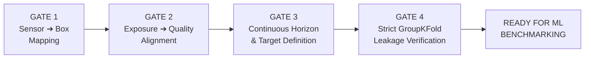

# KẾ HOẠCH DỰ ÁN & BẢNG THEO DÕI TIẾN ĐỘ NCKH
## Đề tài: Biểu diễn phơi nhiễm chuỗi lạnh & Dự báo Remaining Shelf Life (RSL) xoài xuất khẩu

> **Mô hình phối hợp:** 4 Thành viên theo mảng năng lực (Research - Data - ML - Quality/RSL)  
> **Quy tắc làm việc:** Không chia cơ học theo đầu việc, chia theo năng lực cốt lõi nhưng thấu hiểu toàn bộ pipeline chung:  
> `Cold-chain history` $\to$ `Exposure representation` $\to$ `Quality degradation` $\to$ `Estimated RSL` $\to$ `Delivery suitability`

---

## MỤC LỤC
1. [Bảng theo dõi tổng thể 35 nhiệm vụ (Master Task Tracker)](#1-bảng-theo-dõi-tổng-thể-35-nhiệm-vụ)
2. [Phân công chi tiết theo 4 mảng năng lực (Workstreams)](#2-phân-công-chi-tiết-theo-4-mảng-năng-lực)
3. [Ma trận kỹ năng nhóm (Skill Matrix)](#3-ma-trận-kỹ-năng-nhóm)
4. [Checklist chuẩn bị dữ liệu cho ML (Data Prep 10 Stages)](#4-checklist-chuẩn-bị-dữ-liệu-cho-ml-10-stages)
5. [Checklist rút gọn 25 đầu việc cho Kanban/Project Board](#5-checklist-rút-gọn-25-đầu-việc-cho-project-board)
6. [4 Trạm kiểm soát bắt buộc (Gatekeepers)](#6-4-trạm-kiểm-soát-bắt-buộc-gatekeepers)

---

## 1. BẢNG THEO DÕI TỔNG THỂ 35 NHIỆM VỤ

*Quy ước trạng thái:* `[ ]` Chưa bắt đầu | `[-]` Đang thực hiện | `[x]` Đã hoàn thành

| STT | Giai Đoạn | Nhiệm Vụ | Phụ Trách (Owner) | Phối Hợp | Trạng Thái | Ghi Chú / Output |
| :---: | :--- | :--- | :---: | :---: | :---: | :--- |
| **1** | CHUẨN BỊ | Xác định lĩnh vực và chủ đề quan tâm | **M1** | All | `[x]` | Chuỗi lạnh xoài + RSL prediction |
| **2** | CHUẨN BỊ | Đọc 10–20 paper nền tảng (survey papers) | **M1** | M4 | `[-]` | Shelf-life, kinetic models, cold-chain |
| **3** | CHUẨN BỊ | Tìm mentor / giảng viên hướng dẫn | **M1** | All | `[ ]` | Liên hệ GV chuyên ngành Logistics / AI |
| **4** | CHUẨN BỊ | Thiết lập workspace (GitHub, Repo, Tools) | **M1 + M2** | M3 | `[x]` | Repo initialized tại `d:\nckh_qaaa` |
| **5** | TÌM GAP | Đọc sâu 20–30 paper chuyên ngành | **M1** | M4 | `[-]` | Tập trung papers 2023–2026 |
| **6** | TÌM GAP | Phân tích limitations và future work của papers | **M1** | All | `[-]` | Bóc tách điểm yếu của model hiện có |
| **7** | TÌM GAP | Viết literature review sơ bộ (2–3 trang) | **M1** | M4 | `[ ]` | So sánh ML đơn thuần vs Physics/Exposure |
| **8** | TÌM GAP | Xác định research gap cụ thể (1–2 câu) | **M1** | All | `[x]` | Multi-tier exposure + Dynamic RSL + Group split |
| **9** | ĐẶT VẤN ĐỀ | Viết problem statement theo CROPS framework | **M1** | All | `[ ]` | Context, Reality, Outcome, Problem, Solution |
| **10** | ĐẶT VẤN ĐỀ | Đặt Research Questions (2–3 câu hỏi) | **M1 + M4** | M2, M3 | `[x]` | RQ1: Exposure vs Quality; RQ2: RSL Inverse |
| **11** | ĐẶT VẤN ĐỀ | Xác định contributions (What's new?) | **M1** | M2, M3 | `[x]` | Đóng góp Tier 1/2/3 + GroupKFold + Uncertainty |
| **12** | ĐẶT VẤN ĐỀ | Trình bày với mentor, nhận feedback | **All** | — | `[ ]` | Chuẩn bị slide đề cương 10 trang |
| **13** | THIẾT KẾ | Chọn phương pháp nghiên cứu | **M3 + M4** | M1 | `[x]` | Định lượng (Quantitative) + Two-stage ML |
| **14** | THIẾT KẾ | Thiết kế experiments (datasets, metrics) | **M2 + M3 + M4** | M1 | `[x]` | RMSE, MAE, R², Coverage, Pinball loss |
| **15** | THIẾT KẾ | Lên timeline chi tiết (tuần / ngày) | **M1** | All | `[-]` | Lập Gantt chart 12 tuần |
| **16** | THIẾT KẾ | Viết đề cương chi tiết (3–5 trang) | **M1** | All | `[ ]` | Dựa trên Master Research Spec |
| **17** | THIẾT KẾ | Chuẩn bị tài nguyên (data, compute, packages) | **M2 + M3** | — | `[x]` | Python 3.13, sklearn, xgboost, lgb, torch |
| **18** | THỰC HIỆN | Thu thập / tải và làm sạch datasets | **M2** | — | `[x]` | Đã tải toàn bộ 562 files về `data/raw/` |
| **19** | THỰC HIỆN | Implement baseline methods (Ridge, RF) | **M3** | — | `[x]` | Code sẵn trong `src/models/baselines.py` |
| **20** | THỰC HIỆN | Implement proposed methods (Domain feats, DL) | **M2 + M3** | — | `[x]` | Code sẵn `domain_features.py` & benchmark |
| **21** | THỰC HIỆN | Run experiments và ghi lại kết quả | **M3** | M2, M4 | `[-]` | Đã test mock, chờ nạp full raw data |
| **22** | THỰC HIỆN | Phân tích kết quả (Statistical significance) | **M4** | M3 | `[-]` | Wilcoxon signed-rank test & Bootstrap CI |
| **23** | THỰC HIỆN | Debug / optimize nếu cần | **M2 + M3** | — | `[ ]` | Tuning siêu tham số & kiểm tra residual |
| **24** | VIẾT BÁO CÁO| Viết Introduction (bối cảnh, động lực, đóng góp) | **M1** | — | `[ ]` | Khung có sẵn trong spec |
| **25** | VIẾT BÁO CÁO| Viết Related Work (so sánh existing methods) | **M1** | — | `[ ]` | Tổng hợp từ 20–30 paper |
| **26** | VIẾT BÁO CÁO| Viết Methodology (chi tiết phương pháp) | **M2 + M3 + M4** | M1 | `[-]` | Viết từ `src/` và công thức toán học |
| **27** | VIẾT BÁO CÁO| Viết Experiments (datasets, setup, results) | **M3** | M1 | `[-]` | Xuất trực tiếp bảng LaTeX từ script |
| **28** | VIẾT BÁO CÁO| Viết Discussion (phân tích, ý nghĩa sinh học, hạn chế) | **M4 + All** | — | `[ ]` | Giải thích SHAP + hiện tượng mất nước |
| **29** | VIẾT BÁO CÁO| Viết Conclusion và Future Work | **M1 + M4** | — | `[ ]` | Tóm tắt kết quả & mở rộng loại quả khác |
| **30** | HOÀN THIỆN | Định dạng theo template của trường / kỷ yếu | **M1** | — | `[ ]` | Căn lề, font, citation IEEE/APA |
| **31** | HOÀN THIỆN | Kiểm tra grammar, plagiarism | **M1 + All** | — | `[ ]` | Turnitin / Grammarly check |
| **32** | HOÀN THIỆN | Peer review (phản biện chéo và nhờ góp ý) | **All** | — | `[ ]` | Nhờ lab bạn hoặc mentor đọc trước |
| **33** | HOÀN THIỆN | Hoàn thiện code và documentation | **M2 + M3** | — | `[x]` | Đã có README, test pipeline, yaml config |
| **34** | HOÀN THIỆN | Nộp báo cáo / bài báo NCKH | **M1** | All | `[ ]` | Đóng bìa / nộp bản PDF chính thức |
| **35** | HOÀN THIỆN | Chuẩn bị presentation (slides, demo dự báo) | **All** | — | `[ ]` | Slide báo cáo 15 phút + Demo chạy thử |

---

## 2. PHÂN CÔNG CHI TIẾT THEO 4 MẢNG NĂNG LỰC

### 👤 MEMBER 1 — Research Lead (Phương pháp & Học thuật)
- **Mục tiêu tối thượng:** Đảm bảo đề tài có tính mới (Novelty), tính chặt chẽ về học thuật, trả lời trọn vẹn câu hỏi:  
  *“Tại sao phải làm nghiên cứu này và đề tài này vượt trội hơn các công bố trước ở điểm nào?”*
- **Pipeline phụ trách:**
  ```text
  Literature Review ➔ Research Gap ➔ Problem Statement (CROPS) ➔ Research Questions ➔ Paper Writing
  ```
- **Nhiệm vụ cụ thể:**
  - Lead các Task: 1, 2, 3, 4, 5, 6, 7, 8, 9, 10, 11, 15, 16, 24, 25, 29, 30, 31, 34.
  - Xây dựng bản thảo báo cáo (Introduction, Related Work, Conclusion).
  - So sánh đối chiếu với các công bố 2023–2026 (Abougharib 2023, IEEE 2025, Digital Twin Food Eng).
- **Sản phẩm bàn giao (Deliverables):**
  - Đề cương NCKH hoàn chỉnh.
  - Bản thảo bài báo cáo (Overleaf / Word theo template chuẩn).

---

### 👤 MEMBER 2 — Data & Cold-Chain Lead (Dữ liệu & Miền nghiệp vụ)
- **Mục tiêu tối thượng:** Mổ xẻ toàn diện dữ liệu, làm sạch tuyệt đối, tái tạo chuỗi hành trình và xây dựng các biểu diễn phơi nhiễm giàu thông tin sinh học:  
  *“Dữ liệu thực sự có gì, ghép nối thế nào, và lịch sử chuỗi lạnh được biến thành feature ra sao?”*
- **Pipeline phụ trách:**
  ```text
  Raw Data Ingestion ➔ Cleaning & Sampling ➔ Trajectory Reconstruction ➔ Exposure Features (VPD, ΔT) ➔ Leakage-Free Split
  ```
- **Nhiệm vụ cụ thể:**
  - Lead các Task: 14, 17, 18, 20 (phần Feature), 23 (phần Data).
  - Quản lý thư mục `data/raw/` và `data/processed/`.
  - Viết module tái tạo hành trình Step 0 $\to$ Step 10.
  - Tính toán các biến sinh - nhiệt học trong [`src/features/domain_features.py`](file:///d:/nckh_qaaa/src/features/domain_features.py): Thâm hụt áp suất hơi nước (Vapor Pressure Deficit - VPD), Degree-Hours, Thermal Inertia ($\Delta T = T_{mango} - T_{air}$), Excursion count & duration.
  - Đảm bảo 100% không rò rỉ dữ liệu vi khí hậu qua [`src/utils/leakage_guard.py`](file:///d:/nckh_qaaa/src/utils/leakage_guard.py).
- **Sản phẩm bàn giao (Deliverables):**
  - File `data/processed/mango_analysis_ready.parquet`.
  - Data Dictionary đầy đủ định nghĩa từng biến, đơn vị đo và kiểu dữ liệu.

---

### 👤 MEMBER 3 — ML & Experiment Lead (Mô hình hóa & Thực nghiệm)
- **Mục tiêu tối thượng:** Xây dựng hệ thống benchmark đa tầng, huấn luyện các mô hình từ baseline đến SOTA Tabular/DL, trích xuất độ đo khách quan:  
  *“Biểu diễn và mô hình nào dự đoán suy giảm chất lượng chính xác nhất, ổn định nhất?”*
- **Pipeline phụ trách:**
  ```text
  Feature Input Matrix ➔ Model Architecture ➔ GroupKFold CV Loop ➔ Hyperparameter Tuning ➔ Out-of-Fold Residuals
  ```
- **Nhiệm vụ cụ thể:**
  - Lead các Task: 13, 14, 19, 20 (phần Model), 21, 23 (phần Code ML), 27.
  - Phụ trách module [`src/models/baselines.py`](file:///d:/nckh_qaaa/src/models/baselines.py) (Ridge, ElasticNet, Random Forest, LightGBM, XGBoost) và kiến trúc lai Hybrid 1D-CNN + Tabular MLP.
  - Quản lý file cấu hình [`configs/experiment_config.yaml`](file:///d:/nckh_qaaa/configs/experiment_config.yaml).
  - Chạy master benchmark script [`experiments/run_benchmark.py`](file:///d:/nckh_qaaa/experiments/run_benchmark.py).
  - Trích xuất bảng kết quả RMSE, MAE, $R^2$ tự động xuất sang file LaTeX `table_results.tex` cho M1.
- **Sản phẩm bàn giao (Deliverables):**
  - Checkpoints mô hình đã huấn luyện.
  - File log kết quả thực nghiệm `experiments/benchmark_results.csv` và code tính SHAP feature importance.

---

### 👤 MEMBER 4 — Quality / RSL / Statistics Lead (Chất lượng, RSL & Thống kê)
- **Mục tiêu tối thượng:** Chuyển đổi dự báo chất lượng thành thời hạn sử dụng (RSL), định lượng độ bất định, kiểm định thống kê và trả lời bài toán logistics:  
  *“Dự đoán này có ý nghĩa sinh học thực phẩm và quyết định logistics giao hàng hay không?”*
- **Pipeline phụ trách:**
  ```text
  Predicted Degradation Curve ➔ Inverse Solving (t*) ➔ Bootstrap Uncertainty (CI) ➔ Delivery Suitability ➔ Statistical Tests
  ```
- **Nhiệm vụ cụ thể:**
  - Lead các Task: 10, 13, 14, 22, 28, 29.
  - Phụ trách module [`src/rsl/inverse_solver.py`](file:///d:/nckh_qaaa/src/rsl/inverse_solver.py):
    - Thuật toán giải nghịch đảo tìm $t^*$ khi đường cong suy giảm cắt ngưỡng 8%–10% Mass loss.
    - Residual Bootstrap định lượng khoảng tin cậy 95% bất định ($RSL \pm \delta$ ngày).
    - Phân loại rủi ro giao hàng (Delivery Suitability) theo xác suất $P(RSL \ge t_{\text{req}})$.
  - Thực hiện kiểm định giả thuyết thống kê (Wilcoxon signed-rank test / Paired t-test) chứng minh Tier 2 tốt hơn Tier 1 có ý nghĩa thống kê ($p < 0.05$).
  - Viết phần Thảo luận (Discussion): giải thích cơ chế thoát hơi nước và tổn thương lạnh.
- **Sản phẩm bàn giao (Deliverables):**
  - Báo cáo phân tích RSL và khoảng tin cậy.
  - Đồ thị đường cong suy giảm thực phẩm và ma trận rủi ro giao hàng.

---

## 3. MA TRẬN KỸ NĂNG NHÓM (SKILL MATRIX)

| Kỹ Năng Yêu Cầu | M1 (Research) | M2 (Data) | M3 (ML) | M4 (RSL/Stats) |
| :--- | :---: | :---: | :---: | :---: |
| **Literature Search & Review** | ★★★ | ★ | ★ | ★★ |
| **Academic Writing (LaTeX/Paper)** | ★★★ | ★ | ★ | ★★ |
| **Python & Pandas** | ★ | ★★★ | ★★★ | ★★ |
| **Data Engineering & Cleaning** | ★ | ★★★ | ★★ | ★ |
| **Feature Engineering (Domain/Physiology)** | ★ | ★★★ | ★★★ | ★★ |
| **Machine Learning & Deep Learning** | ★★ | ★★ | ★★★ | ★★ |
| **Statistics & Hypothesis Testing** | ★★ | ★ | ★★ | ★★★ |
| **Food Quality Degradation Kinetics** | ★ | ★★ | ★★ | ★★★ |
| **Remaining Shelf Life (RSL) Concepts** | ★ | ★ | ★★ | ★★★ |
| **Slide Presentation & Demo** | ★★★ | ★★ | ★★ | ★★ |

---

## 4. CHECKLIST CHUẨN BỊ DỮ LIỆU CHO ML (10 STAGES)

### STAGE 1 — Kiểm kê dữ liệu (Data Inventory)
- [ ] **1.1. Liệt kê toàn bộ file:**
  - [ ] Sensor raw logs (nhiệt độ không khí, nhiệt độ quả, độ ẩm)
  - [ ] Quality measurements (khối lượng, màu $b^*$, pH, TSS theo từng ngày)
  - [ ] Metadata chặng vận chuyển (Packing house, xe tải, sân bay, chuyến bay, phòng lab)
  - [ ] Hình ảnh chụp quả (nếu có để đối chiếu trực quan)
- [ ] **1.2. Xác định cấu trúc thư mục lưu trữ:**
  - [ ] `data/raw/sensor/`
  - [ ] `data/raw/quality/`
- [ ] **1.3. Xây dựng Data Dictionary:**
  - [ ] Bảng định nghĩa: Tên cột, Ý nghĩa vật lý, Đơn vị đo ($^\circ\text{C}, \%, \text{g}, \text{ngày}$), Kiểu dữ liệu (`float`, `datetime`).
- [ ] **1.4. Xác định phân cấp thực thể (Entity Hierarchy):**
  - [ ] `Shipment_ID` $\to$ `Pallet_ID` $\to$ `Box_ID` $\to$ `Mango_ID` $\to$ `Sensor_ID`.

### STAGE 2 — Hiểu cấu trúc chuỗi thời gian
- [ ] **2.1. Tái dựng tiến trình chuỗi lạnh (Timeline):**
  - [ ] Step 0 (Đóng gói) $\to$ Step 1 (Tiền lạnh) $\to$ Step 2 (Xe lạnh) $\to \dots \to$ Step 7 (Bay) $\to$ Step 8 (Sân bay đến) $\to$ Step 10 (Điểm đến / Lưu kho).
- [ ] **2.2. Kiểm chuẩn mốc thời gian (Timestamps):**
  - [ ] Đồng bộ múi giờ (UTC vs Local time của nước xuất khẩu/nhập khẩu).
  - [ ] Kiểm tra bước nhảy thời gian (sampling step: 5 phút / 10 phút / 15 phút).
  - [ ] Phát hiện mốc thời gian bị lặp hoặc mất quãng (gaps).
- [ ] **2.3. Ánh xạ Sensor $\leftrightarrow$ Thùng hàng:**
  - [ ] Xác định rõ cảm biến nào đo nhiệt độ quả (tiếp xúc), cảm biến nào đo không khí thùng, cảm biến nào đo khoang ngoài.

### STAGE 3 — Làm sạch & Xác thực dữ liệu
- [ ] **3.1. Xử lý giá trị khuyết thiếu (Missing values):**
  - [ ] Thống kê tỷ lệ khuyết theo từng sensor và từng chặng bay.
  - [ ] Quyết định giải pháp: Nội suy tuyến tính nếu gap $< 30$ phút; cảnh báo nếu mất chuỗi dài.
- [ ] **3.2. Loại bỏ bản ghi trùng lặp (Duplicates):**
  - [ ] Loại bỏ bản ghi trùng timestamp và sensor ID.
- [ ] **3.3. Kiểm tra giá trị vô lý vật lý (Invalid values):**
  - [ ] Nhiệt độ $< -50^\circ\text{C}$ hoặc $> 60^\circ\text{C}$ (lỗi pin cảm biến).
  - [ ] Độ ẩm $RH < 0\%$ hoặc $RH > 100\%$.
- [ ] **3.4. Phân biệt Nhiệt độ Sốc (Real Excursion) vs Lỗi Cảm biến:**
  - [ ] Không tự tiện xóa nhiệt độ tăng vọt vì đó chính là đợt sốc nhiệt (đặc trưng nghiên cứu)!
- [ ] **3.5. Kiểm tra tính đều đặn của chu kỳ lấy mẫu (Sampling consistency):**
  - [ ] Đồng bộ về bước mẫu chuẩn hóa (resampling về 5 phút/điểm).

### STAGE 4 — Tái tạo chuỗi phơi nhiễm (Trajectory Reconstruction)
- [ ] **4.1. Tạo chuỗi liên tục theo từng Box (`box_trajectory`):**
  - [ ] Nối liên hoàn từ Step 0 đến Step 10.
- [ ] **4.2. Ghép đồng bộ $T_{air}(t)$, $T_{mango}(t)$ và $RH(t)$:**
- [ ] **4.3. Chốt cửa sổ phơi nhiễm (Exposure Window):**
  - [ ] Thời gian từ lúc thu hoạch/đóng gói đến khi hàng cập cảng/kho đích (Day 0 lưu kho).

### STAGE 5 — Ghép nối Phơi nhiễm với Đo đạc Chất lượng (Link Exposure $\leftrightarrow$ Quality)
- [ ] **5.1. Xác định đơn vị đo chất lượng:** Đơn vị là từng quả xoài (`mango_id`) nằm trong thùng (`box_id`).
- [ ] **5.2. Đồng bộ thời điểm đo chất lượng sau vận chuyển:**
  - [ ] Day 0, Day 3, Day 6, Day 9, Day 12, Day 15.
- [ ] **5.3. Kiểm tra tính toàn vẹn 1-nhiều (One-to-Many check):**
  - [ ] 1 Box trajectory $\to$ gắn với $N$ quả xoài trong thùng đó.
- [ ] **5.4. Xử lý các mẫu không khớp (Unmatched records):**
  - [ ] Ghi biên bản giải trình nếu có Box có sensor nhưng thiếu file cân khối lượng hoặc ngược lại.

### STAGE 6 — Xây dựng Bộ đặc trưng Học máy (Feature Engineering)
- [ ] **6.1. Tier 1 - Thống kê cơ bản (Summary Stats):**
  - [ ] Mean, Min, Max, Std của $T_{air}, T_{mango}, RH$.
  - [ ] Thời lượng vận chuyển tổng cộng (`transit_duration_hours`).
- [ ] **6.2. Tier 2 - Đặc trưng miền sinh học & chuỗi lạnh (Domain Features):**
  - [ ] Thâm hụt áp suất hơi nước VPD (Mean, Max, Tích phân theo giờ).
  - [ ] Tích phân độ-giờ tổn thương lạnh (Chilling degree-hours $< 12^\circ\text{C}$).
  - [ ] Tích phân độ-giờ ứng suất nhiệt (Heat degree-hours $> 20^\circ\text{C}, > 25^\circ\text{C}$).
  - [ ] Số lần sốc nhiệt và tổng thời lượng sốc nhiệt (Excursion count & duration).
  - [ ] Gradient quán tính nhiệt: $\Delta T = T_{mango} - T_{air}$ (Mean, Std, Max).
- [ ] **6.3. Tier 3 - Đặc trưng chuỗi tiềm ẩn (Sequential DL Embedding):**
  - [ ] Vector biểu diễn $z \in \mathbb{R}^{16}$ từ mạng 1D-CNN trích xuất trực tiếp từ chuỗi $3 \times L$.

### STAGE 7 — Xác định Nhãn mục tiêu (Target Formulation)
- [ ] **7.1. Primary Target:**
  - [ ] Tỷ lệ tổn thất khối lượng tích lũy: $\text{Mass Loss } (\%) = \frac{m_0 - m_t}{m_0} \times 100\%$.
- [ ] **7.2. Secondary Target:**
  - [ ] Biến thiên màu sắc vỏ/thịt quả $\Delta b^*$ hoặc $b^*$ đo bằng colorimeter.
- [ ] **7.3. Trục thời gian truy vấn (Query Horizon):**
  - [ ] Tham số thời gian lưu kho $t \in [0, 15]$ ngày được đưa vào làm đầu vào bổ sung để mô hình dự báo đường cong suy giảm liên tục.

### STAGE 8 — Chống rò rỉ dữ liệu & Chiến lược phân chia Fold (Leakage Prevention)
- [ ] **8.1. Đơn vị độc lập (Independent Unit):** Khóa cứng đơn vị phân chia là `box_id`.
- [ ] **8.2. Nghiêm cấm Random Split theo dòng:** Không chia ngẫu nhiên từng quả xoài nếu chúng ở chung thùng.
- [ ] **8.3. Thiết lập GroupKFold (5 Folds):**
  - [ ] Mọi fold phải chạy qua hàm `verify_no_group_leakage()`.
- [ ] **8.4. Chặn rò rỉ thời gian (Temporal Leakage):**
  - [ ] Tuyệt đối không dùng thông tin đo đạc tại Day 9 hay Day 12 để làm đặc trưng dự báo cho Day 3.

### STAGE 9 — Khám phá dữ liệu trước khi huấn luyện (EDA)
- [ ] **9.1. Phân bố nhiệt độ và độ ẩm qua các chặng logistics.**
- [ ] **9.2. Phân tích tương quan giữa VPD tích lũy và tốc độ mất khối lượng.**
- [ ] **9.3. Biểu đồ phân bố của nhãn Mass Loss theo từng mốc ngày lưu kho.**
- [ ] **9.4. Kiểm tra đa cộng tuyến (Multicollinearity check) giữa các biến nhiệt độ.**

### STAGE 10 — Đóng băng tập dữ liệu sẵn sàng cho ML (Freeze Dataset)
- [ ] **10.1. Xuất file chuẩn hóa:** `data/processed/mango_analysis_ready.parquet`.
- [ ] **10.2. Lưu trữ file chỉ số phân chia fold:** `configs/splits_groupkfold.json`.
- [ ] **10.3. Ghi log phiên bản:** Commit hash của code tiền xử lý kèm checksum dữ liệu.
- [ ] **10.4. ĐÓNG DẤU: READY FOR MODELING.**

---

## 5. CHECKLIST RÚT GỌN 25 ĐẦU VIỆC CHO PROJECT BOARD

```text
[ ] 01. Kiểm kê toàn bộ file và thư mục dữ liệu gốc
[ ] 02. Xây dựng Data Dictionary chuẩn (tên biến, đơn vị, kiểu)
[ ] 03. Xác định phân cấp thực thể ID (Shipment -> Box -> Mango)
[ ] 04. Tái dựng trục thời gian logistics (Step 0 -> Step 10)
[ ] 05. Kiểm chuẩn timestamp và tần suất lấy mẫu (resampling 5 min)
[ ] 06. Làm sạch missing, duplicate và loại bỏ giá trị dị thường
[ ] 07. Xác thực các đợt sốc nhiệt thực tế (Temperature excursions)
[ ] 08. Ánh xạ chính xác Sensor -> Box -> Chặng vận chuyển
[ ] 09. Khớp nối dữ liệu phơi nhiễm với bảng đo chất lượng (Day 0-15)
[ ] 10. Xử lý và ghi biên bản các mẫu không khớp
[ ] 11. Cắt cửa sổ phơi nhiễm vận chuyển (D0 arrival)
[ ] 12. Xác định nhãn mục tiêu chính (Mass Loss %) và phụ (Color b*)
[ ] 13. Định hình bài toán hàm suy giảm liên tục theo thời gian t
[ ] 14. Trích xuất đặc trưng Tier 1: Summary Statistics
[ ] 15. Trích xuất đặc trưng Tier 2: Domain Features (VPD, Degree-Hours)
[ ] 16. Trích xuất đặc trưng tương tác: Delta T (Mango - Air)
[ ] 17. Kiểm tra phân bố đặc trưng và xử lý phân phối lệch
[ ] 18. Kiểm tra phân bố nhãn mục tiêu
[ ] 19. Xác lập Group ID độc lập (box_id)
[ ] 20. Cài đặt và unit test bộ chia GroupKFold (Leakage-free)
[ ] 21. Chạy EDA trực quan hóa mối quan hệ VPD -> Mass loss
[ ] 22. Soạn thảo tài liệu quyết định tiền xử lý dữ liệu
[ ] 23. Đóng băng tập dữ liệu phân tích (analysis-ready dataset)
[ ] 24. Đánh số phiên bản (Version control data + code)
[ ] 25. BẬT ĐÈN XANH CHẠY MODELING BENCHMARK
```

---

## 6. 4 TRẠM KIỂM SOÁT BẮT BUỘC (GATEKEEPERS)

> [!CAUTION]
> **Tuyệt đối không chạy mô hình Machine Learning / Deep Learning nếu chưa vượt qua 4 trạm kiểm soát này!**



1. **Gate 1: Sensor $\leftrightarrow$ Box Mapping:**  
   Xác minh 100% cảm biến nhiệt độ không khí và nhiệt độ quả được gắn đúng số hiệu thùng hàng. Không chấp nhận tình trạng râu ông nọ cắm cằm bà kia.
2. **Gate 2: Exposure $\leftrightarrow$ Quality Alignment:**  
   Mọi quả xoài đem ra huấn luyện mô hình phải gắn liền chính xác với lịch sử phơi nhiễm của thùng chứa nó. Nếu mất dữ liệu hành trình của thùng nào, phải loại bỏ hoặc ghi chú riêng.
3. **Gate 3: Continuous Horizon & Target Definition:**  
   Nhãn mục tiêu $\text{Mass Loss } (\%)$ phải được tính toán chuẩn hóa tương đối so với khối lượng ban đầu Day 0. Tham số thời gian lưu kho $t$ phải được đưa vào để giải hàm suy giảm.
4. **Gate 4: GroupKFold Leakage Guard:**  
   Bắt buộc chạy qua hàm `verify_no_group_leakage()` trong [`src/utils/leakage_guard.py`](file:///d:/nckh_qaaa/src/utils/leakage_guard.py). Nếu có bất kỳ `box_id` nào xuất hiện ở cả 2 tập Train và Test $\to$ **Dừng hệ thống ngay lập tức!**
